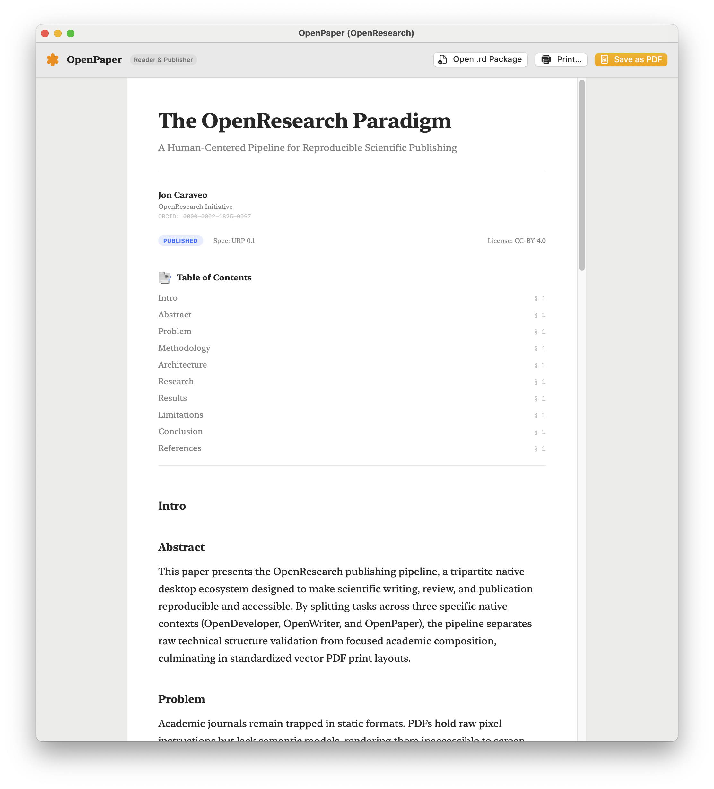

# OpenResearch


OpenResearch is a document system for collecting what you learn, writing what you know, and taking the work with you. Build a research notebook, manuscript, engineering handbook, or study guide in structured Markdown. Package it as a single editable `.rd` file you can duplicate, send to a colleague, or back up wherever you keep your files.

[Browse releases](https://github.com/caraveo/OpenResearch/releases) · [Get started](#get-started) · [Try the sample .rd file](paper.rd)

**Now supports Linux.** Install the Qt 6 editions of OpenPaper, OpenWriter, and OpenDeveloper on Ubuntu. The original Swift editions are available for macOS.

## Who it's for

| If you're a… | Start with… |
| --- | --- |
| **Researcher** | A lab notebook with hypotheses, methods, results, and references, or a draft paper your coauthor can pick up. |
| **Writer** | A manuscript with an outline, chapter drafts, interview notes, and source citations. |
| **Developer** | An architecture brief with code examples, decision records, and handoff notes. |
| **Student or educator** | A study guide with reading summaries, worked examples, and review questions, or a lesson packet to share with a class. |
| **Independent learner or team** | A field notebook, project playbook, or reusable template that someone else can copy and adapt. |

## How it works

1. **Capture and write.** Draft in OpenWriter or work directly with the Markdown source in OpenDeveloper. Use headings to keep notes, drafts, and references together.
2. **Package your work.** In OpenDeveloper, choose **Build & Export** → **Package .rd**. The resulting archive contains the editable document and its metadata.
3. **Read or publish.** Open the package in OpenPaper for reading, printing, or PDF export. OpenDeveloper also offers exports such as HTML, EPUB, LaTeX, and Markdown.

## Your second brain in one file

Think of each `.rd` as a portable notebook for a project or topic. For example, keep a literature review, your synthesis, and the bibliography in `climate-literature.rd`. When a colleague joins the project, send them the file. They can open it in OpenWriter, or open a duplicate and take the research in their own direction.

- **Clone a starting point.** Duplicate a study guide, project brief, or lab notebook in Finder. Rename the copy and use it for the next course, project, or experiment.
- **Share the editable source.** Send the `.rd` file by email or through a shared folder when someone needs to build on the work. Share a PDF when they need a reading copy.
- **Keep your own backups.** Copy the `.rd` to an external drive, or upload it to Google Drive, Dropbox, iCloud Drive, or another storage service. Save dated copies to keep milestones you can reopen later.

The native packaging workflow bundles the document source and manifest. If your document links to external datasets, PDFs, or media, keep those files with your backup or share them alongside the archive.

## The apps

| App | Use it to |
| --- | --- |
| **OpenWriter** | Draft and edit with a focused writing interface. |
| **OpenPaper** | Read `.rd` documents, print, and export PDFs. |
| **OpenDeveloper** | Edit source with a live preview, check document conformance, and package or export your work. |

<p align="center">
  
</p>

## Get started

### Linux (Ubuntu) with Qt 6

Run this in a terminal as your desktop user. The installer uses `sudo` to install any missing Ubuntu dependencies and installs the apps for your account.

```sh
curl -fsSL https://github.com/Caraveo/openresearch/releases/latest/download/install-linux.sh | sh
```

Launch **OpenPaper**, **OpenWriter**, or **OpenDeveloper** from **Show Apps**. To pin an app to the Ubuntu dock, right-click its icon and choose **Pin to Dash**. Run the same command to upgrade.

#### Run from source

```bash
sudo apt install python3-venv libxcb-cursor0 libnss3 libegl1 libgl1 libopengl0 graphviz pandoc
python3 -m venv .venv
.venv/bin/python -m pip install -r requirements.txt

./OpenWriter/run-qt paper.rd
./OpenPaper/run-qt paper.rd
./OpenDeveloper/run-qt paper.rd
```

OpenWriter shows a section outline and formatted cards. Choose **Edit section** to write or **Paper details** to update metadata. OpenDeveloper puts live preview beside the source and has separate validation and publishing tabs. OpenPaper opens documents read-only and offers printing and publishing. The Qt apps can publish PDF, HTML, Markdown, LaTeX, DOCX, and EPUB through OpenDeveloper or OpenPaper.

In either editor, type `/dimension` on a new line and press Enter, or choose **Insert → Dimension**. Attach a glTF 2.0 `.glb` or `.gltf` file. Relative buffers and textures are included in the `.rd` archive. Click **View 3D model** in the rendered paper to orbit, pan, or zoom. The viewer uses the Three.js distribution vendored by [Dimension](https://github.com/caraveo/dimension) and works offline in the desktop apps. Interactive HTML exports use their accompanying `.files` directory. Serve both together over HTTP or HTTPS to enable the model viewer. PDF and print include the model caption.

```bash
.venv/bin/python -m openresearch_qt validate paper.rd
.venv/bin/python -m openresearch_qt build paper.rd paper.pdf
.venv/bin/python -m openresearch_qt package paper.rd copy.rd
```

### macOS with Swift

The Swift apps target **macOS 14 or later**. Browse [GitHub Releases](https://github.com/caraveo/OpenResearch/releases) or build from source with Swift 5.9 or later.

```bash
git clone https://github.com/caraveo/OpenResearch.git
cd OpenResearch
swift run --package-path OpenPaper
```

In OpenPaper, choose **Open .rd Package** and select [paper.rd](paper.rd) from the repository. To launch the writer or developer tools from source, substitute `OpenWriter` or `OpenDeveloper` for `OpenPaper` in the command.

## Inside an `.rd` file

OpenResearch uses the Universal Research Paper (URP) package format. A native `.rd` package is a ZIP archive you can inspect with standard archive tools. The example below shows the contents of [the sample package](paper.rd).

```text
paper.rd
├── paper.rd.md   # Editable document source
└── urp.yaml      # Machine-readable metadata
```

The structured source can describe research elements such as equations and claims. OpenDeveloper's validation panel checks URP conformance, including metadata, required sections, and accessibility details such as image alt text.

## Contributing

Share use cases, report bugs, or suggest improvements in [GitHub Issues](https://github.com/caraveo/OpenResearch/issues). Pull requests are welcome.

## License

Code is MIT. Documentation and papers are CC BY 4.0.
